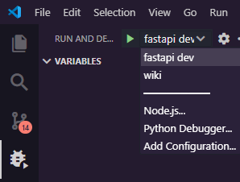
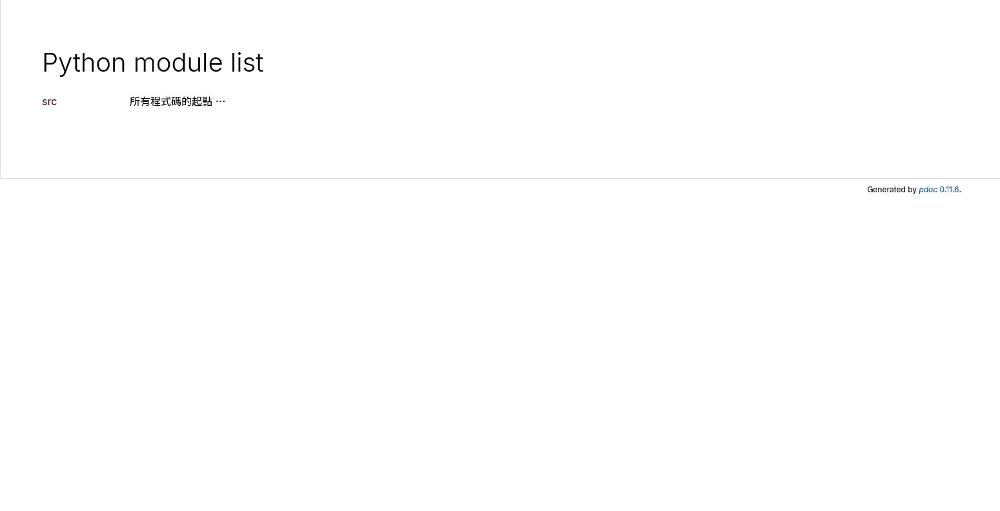
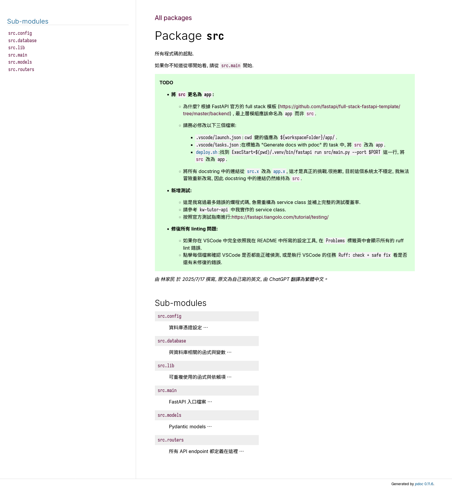
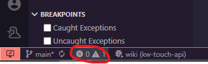
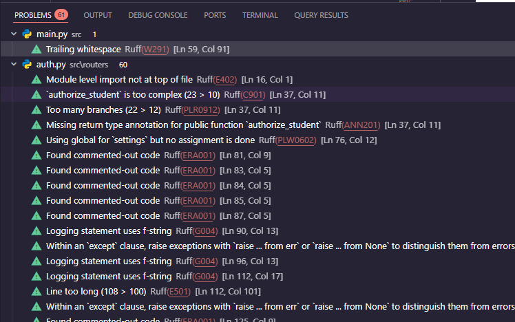
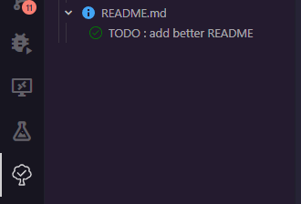

# 補位機系統 (後端)

## 基本資訊
- 正式 (前端) 網址: [https://intsys.kaowei.tw/touch](https://intsys.kaowei.tw/)
- 正式 (後端) Swagger: 
- 測試 (後端) Swagger: 
- 前端 Gitea repo: 
- 以 [FastAPI](https://fastapi.tiangolo.com/) 製作

## 環境 (皆必要!)
1. [安裝 uv](https://docs.astral.sh/ruff/installation/)
2. [下載 MS ODBC Driver 18 (Windows)](https://learn.microsoft.com/en-us/sql/connect/odbc/download-odbc-driver-for-sql-server?view=sql-server-ver16#download-for-windows)
3. [安裝 VSCode](https://code.visualstudio.com/download)
4. 建議你[開一個新的 VSCode Profile](https://code.visualstudio.com/docs/configure/profiles)
5. VSCode 提示你[建議安裝的擴充元件](./.vscode/extensions.json), **一定要安裝**!

6. Python 虛擬環境可直接打開 Powershell/Terminal/終端機，跑 `uv sync` 或是 `Ctrl/Cmd + Shift + P` 並選擇 `UV: Sync Dependencies`

> 基於 PyCharm 的指示我找時間再補

## 使用指南

### 偵錯(Ctrl +  Shift + D)

#### **fastapi dev**
與在Powershell/Terminal/終端機上跑 `fastapi dev app/main.py` 一樣，只不過少打幾個字，去 [http://localhost:8000/docs](http://localhost:8000/docs) 就有 Swagger API Docs。

#### **wiki**
跑之後，在 [http://localhost:8080](http://localhost:8080) 會有一個解釋 所有source code 的 wiki，**強烈建議你全部讀一遍!!!**

### Linting
這就是由 [Ruff](https://docs.astral.sh/ruff/) 找出來的問題，盡你所能解決所有問題!

### 待辦事項
如果你有裝建議安裝的擴充元件，在左邊 Sidebar按這個打開 TODO Tree:

只要在code任何地方打 `# T_ODO add better README`(把中間底線去掉，我加底線是為了不讓TODO Tree highlight這邊)，在 TODO Tree 就會出現。

## 貢獻
- 林家民 (2025/10~)

## 聯絡 (僅此專案技術支援，謝絕推銷)
- 林家民 (Johnny/LostMyPillow)
  - [jmlin0101@gmail.com](mailto:jmlin0101@gmail.com)
  - Discord: `lostmypillow`
  - 
